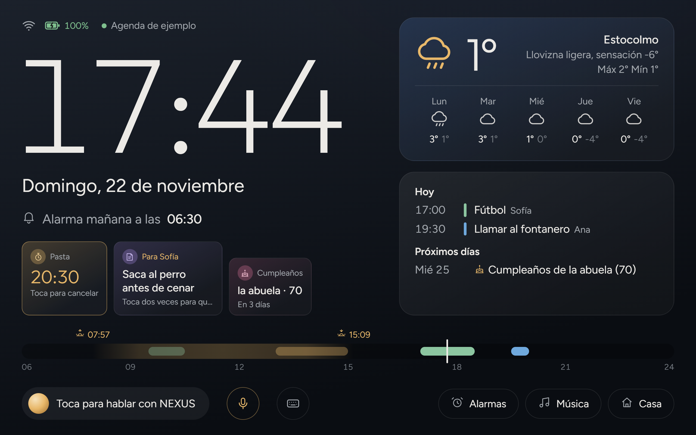
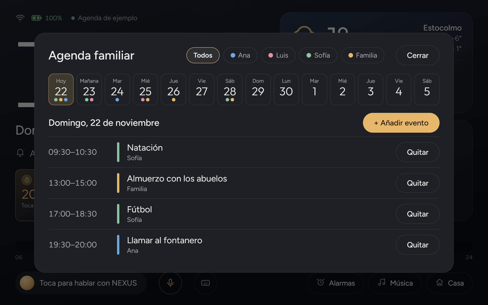
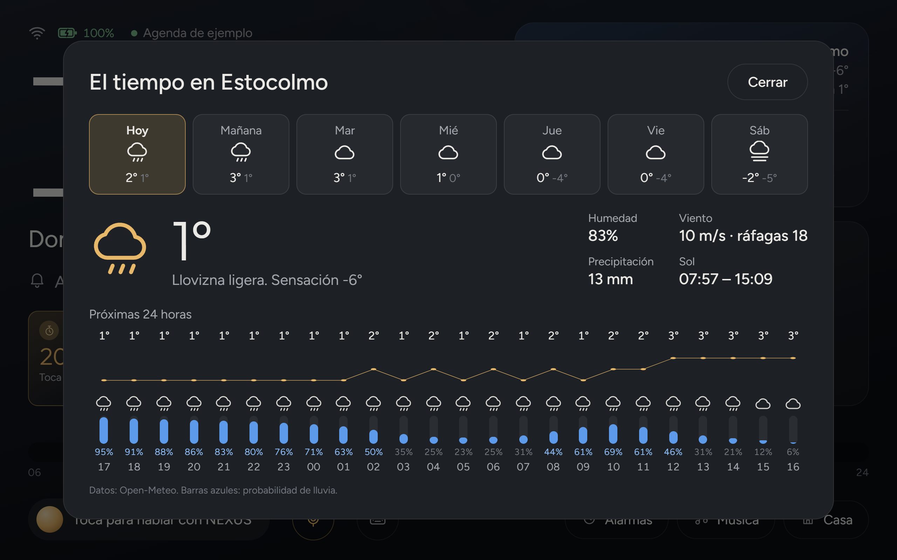
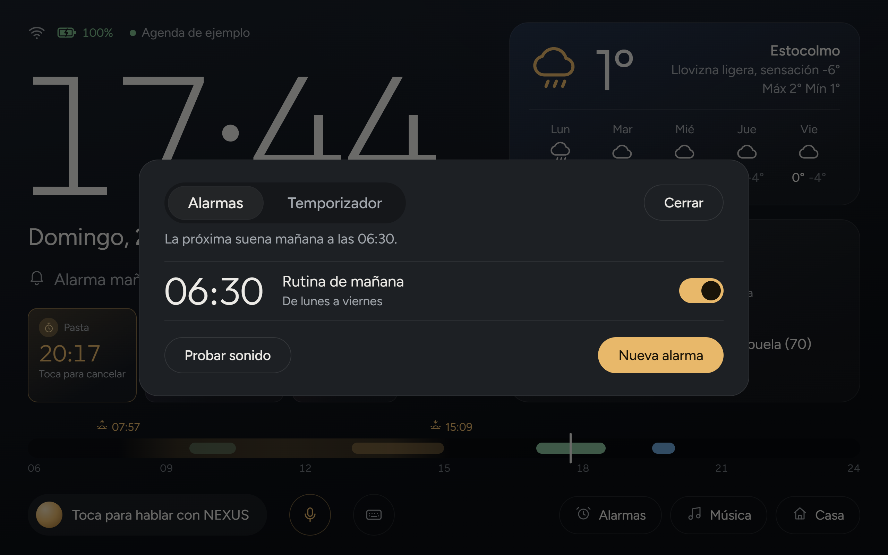
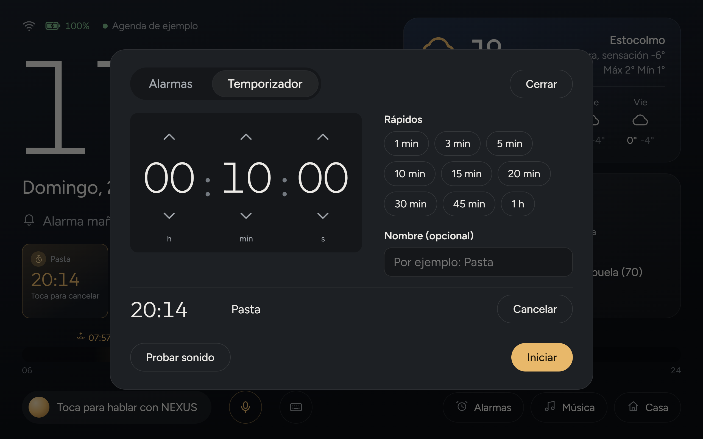
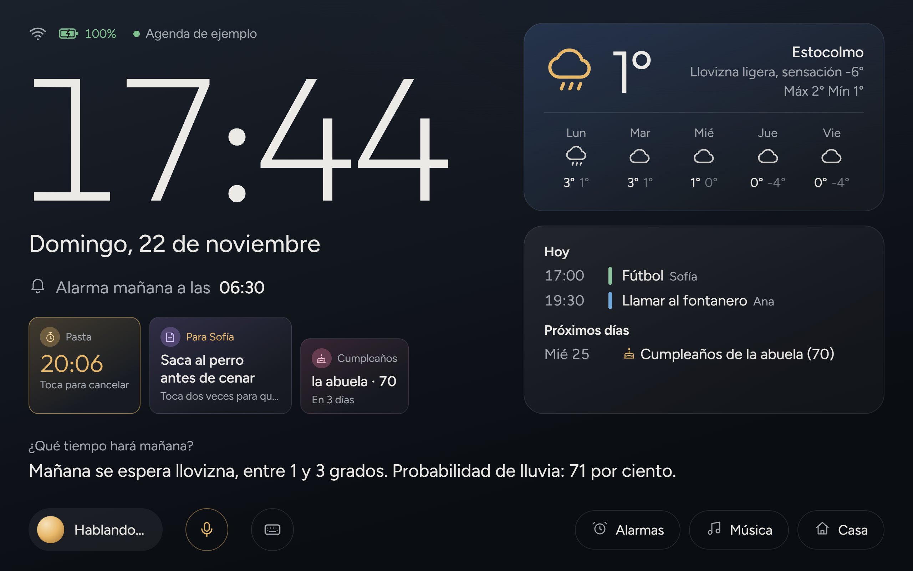

# NEXUS Home

**Panel de control del hogar para una tablet en la pared, con asistente de voz en español. Coste: 0 €.**

*A wall-mounted smart home dashboard for an old Android tablet: clock, weather, family calendar,
alarms, timers, shopping list, electricity prices and a Spanish voice assistant ("Oye NEXUS").
Runs entirely on Cloudflare's free tier. Built for Sweden (SMHI warnings, SE1–SE4 electricity prices).*



## Qué hace

- **Reloj, fecha y próxima alarma**, con una línea de tiempo del día (amanecer, atardecer y eventos).
- **Tiempo** (Open-Meteo) con detalle por horas y avisos oficiales de **SMHI**.
- **Agenda familiar** de Google Calendar, interactiva: ver 14 días, filtrar por persona, añadir y quitar
  eventos. También para quien no tiene cuenta de Google (un niño).
- **Asistente de voz "Oye NEXUS"**: entiende y responde en español, crea alarmas, temporizadores y eventos,
  añade cosas a la lista, deja notas, abre Spotify o YouTube.
- **Alarmas** con melodía suave que va creciendo, **temporizadores** con su propio sonido y rutina de
  buenos días: un resumen hablado con el tiempo, la agenda y recomendaciones (ropa, paraguas, luz barata).
- **Precio real de la luz**: spot más red, impuesto, IVA y tu contrato, y aviso de la hora más barata para
  la lavadora.
- **Gasto de luz del mes** sin contador conectado: NEXUS lo estima con tu consumo habitual y el precio de
  cada hora. Cuando llega la factura, apuntas los kWh del mes desde el móvil y el cálculo queda exacto.
- **Lista de la compra y notas** compartidas desde el móvil (sin instalar nada). Los cambios llegan al panel
  **al instante** (conexión en vivo por WebSocket), y una nota nueva suena con un aviso corto.
- **Notas de voz**: se graban desde el móvil (hasta 1 minuto). En el panel aparecen como una tarjeta azul
  que se toca para escucharla. Se puede escuchar como máximo 2 veces y luego se borra sola (o antes, con «Quitar»).
- **Cumpleaños y aniversarios** (también los de los contactos del iPhone con un Atajo: [guía](docs/atajo-cumpleanos.md)), rutinas ("me voy", "ya llegué", "buenas noches") y **modo noche**.
- **Recordatorios con hora** («recuérdame mañana a las 18 sacar la basura»): suenan en el panel.
- **Tareas de la casa** que se repiten (regar las plantas cada 3 días) con turnos que rotan solos.
- **Modo invitados**: un QR en el panel (o un enlace desde el móvil) para que una visita use la lista
  y las notas durante 24 horas, sin ver nada más.
- **Resumen de la semana** el domingo por la tarde: agenda, cumpleaños, basura, tareas, tiempo y luz.
- **Aviso de luz barata o cara** en el panel y **comparación** del gasto con el contrato anterior.
- **Casa**: luces y enchufes Shelly (opcional).

| | |
|---|---|
|  |  |
|  |  |
|  |  |

Más capturas en [`docs/capturas`](docs/capturas).

## Cómo está montado

```
Tablet (app Android mínima)  ──HTTPS──>  Cloudflare Worker  ──>  Open-Meteo, SMHI (tiempo y avisos)
  página web a pantalla completa          src/  (servidor)  ──>  elprisetjustnu.se (precio de la luz)
  micrófono, alarmas, sonidos             public/ (panel)   ──>  Google Calendar (cuenta de servicio)
                                          KV (datos)        ──>  Workers AI: Whisper (voz → texto),
                                          Durable Object (avisos en vivo)
Móvil (navegador) ── lista y notas                                gpt-oss-120b (asistente), Aura-2 (voz)
```

- **Las claves nunca están en la tablet ni en el código.** Se guardan como *secrets* de Cloudflare.
  La tablet solo guarda un código de emparejamiento, que puedes revocar.
- **Lo barato primero:** las preguntas habituales (hora, tiempo, temporizadores, lista, luz…) se
  responden sin IA. Así la cuota gratuita diaria de Workers AI dura mucho más.
- **Tolerancia a fallos:** si se acaba la cuota, se usa la voz de la tablet. Si falla Google, el resto
  del panel sigue funcionando. Sin Google configurado, arranca con una agenda de ejemplo.

| Carpeta | Qué es |
|---|---|
| `public/` | Panel: `index.html`, `css/app.css`, `js/` (`app.js`, `home.js`, `alarms.js`, `agenda.js`, `voice.js`, `wake.js`…) y `movil.html` |
| `src/` | Servidor: `index.js` (rutas y seguridad), `config.js` (tu casa), `assistant.js`, `quick.js`, `calendar.js`, `extras.js`, `household.js`… |
| `android/` | App de quiosco (`MainActivity.java`) y `build.ps1` para compilarla sin Android Studio |

## Instalación

Necesitas una cuenta gratuita de [Cloudflare](https://dash.cloudflare.com/sign-up) y [Node.js](https://nodejs.org) 20 o más reciente.

1. **Descarga e instala las dependencias**
   ```powershell
   git clone <este repositorio>; cd nexus-home; npm install; npx wrangler login
   ```
2. **Crea tu almacén de datos** y pon el `id` que te devuelve en `wrangler.jsonc` (`kv_namespaces`):
   ```powershell
   npx wrangler kv namespace create NEXUS_KV
   ```
3. **Crea dos claves**: una para la tablet y otra para los móviles. Ejecuta este comando dos veces:
   ```powershell
   node -e "console.log(require('crypto').randomBytes(24).toString('hex'))"
   ```
   Guárdalas en Cloudflare:
   ```powershell
   npx wrangler secret put NEXUS_TOKEN
   ```
   ```powershell
   npx wrangler secret put FAMILY_TOKEN
   ```
4. **Configura tu casa**: copia `nexus-home.example.json`, cambia la ciudad, las coordenadas, la zona de
   precio (SE1–SE4), los nombres de la familia, tu contrato de luz, la cuota fija de la red al mes
   (`gridMonthlyKr`) y tu consumo anual aproximado (`yearKwh`). Pega el JSON (en una línea) en:
   ```powershell
   npx wrangler secret put NEXUS_HOME
   ```
5. **Publica**
   ```powershell
   npx wrangler deploy
   ```
6. **Abre el panel** en la tablet: `https://<tu-worker>.workers.dev/#token=<NEXUS_TOKEN>`. La clave se
   guarda en la tablet y desaparece de la dirección. En el móvil:
   `https://<tu-worker>.workers.dev/movil.html#k=<FAMILY_TOKEN>`, y después *Añadir a pantalla de inicio*.

### Opcional: Google Calendar
1. En [Google Cloud](https://console.cloud.google.com) crea un proyecto, activa la **Google Calendar API**
   y crea una **cuenta de servicio** con una clave JSON.
2. Cada persona comparte su calendario con el correo de la cuenta de servicio (permiso *Hacer cambios
   en eventos*).
3. Guarda los dos secretos:
   - `GOOGLE_SA`: el contenido del JSON;
   - `GOOGLE_CALENDARS`: `[{"who":"ana","name":"Ana","color":"#6fa8dc","id":"ana@gmail.com"}, …]`.

   Para alguien sin cuenta de Google, añade `"host":"ana"` y el `id` del calendario de esa persona
   anfitriona.

### Opcional: app Android de quiosco
Mantiene la pantalla encendida, da permiso de micrófono y abre el panel a pantalla completa.
1. Crea estos archivos (están excluidos de git):
   - `android/host.txt`, con la dirección de tu Worker;
   - `secrets/keystore-pass.txt`, con una contraseña para la clave de firma.
2. Compila la app (necesita el JDK 17 y las *build-tools* del SDK de Android):
   ```powershell
   powershell -ExecutionPolicy Bypass -File android\build.ps1
   ```
3. Instala `android\nexus.apk` en la tablet con `adb install -r`.

### Opcional: luces Shelly
En la app Shelly Smart Control, ve a *Ajustes de usuario → Authorization cloud key*. Guarda la clave y el
servidor como secretos `SHELLY_AUTH_KEY` y `SHELLY_SERVER`. Después registra los dispositivos con
`PUT /api/devices`.

## Uso diario

- **Publicar un cambio:** sube `VERSION` en `src/index.js` y ejecuta `npx wrangler deploy`. La tablet se
  recarga sola.
- **Probar en el PC:** copia `.dev.vars.example` como `.dev.vars`, ejecuta `npm run dev` y abre
  `http://localhost:8787/#token=<tu NEXUS_TOKEN de .dev.vars>`.
- **Cambiar la voz:** cambia `TTS_VOICE` en `wrangler.jsonc`. Opciones: sirio, nestor, carina, celeste,
  alvaro, diana, aquila, selena, estrella, javier.
- **Salir al sistema en la tablet:** mantén pulsada la fecha 3 segundos.
- **Modo noche:** de domingo a jueves desde las 22:00, y los viernes y sábados desde las 00:00. Despierta a
  las 07:00 entre semana y a las 08:00 el fin de semana. El horario está en `public/js/app.js`
  (`NIGHT_START` / `NIGHT_END`).
- **Cuota gratuita de IA:** 10.000 neuronas al día, que se reinician a las 00:00 UTC. Desde el 70 % aparece
  un aviso en el panel.

## Montaje en la pared

- **Altura:** a la de los ojos de pie (unos 140–155 cm al centro), cerca de un enchufe.
- **Ubicación:** a menos de 2–3 m de donde se habla, y lejos del sol y de fuentes de calor.
- **Ventilación:** deja libres los altavoces y el micrófono, y algo de aire detrás.
- **Carga:** usa un cargador de pared de 5 V / 2 A y un cable USB-C largo. Si la tablet lo permite, activa
  *Proteger batería* (carga al 85 %).
- **Mantenimiento:** revisa de vez en cuando que la batería no se hinche.

## Licencia

[MIT](LICENSE). Úsalo, cámbialo y compártelo.
